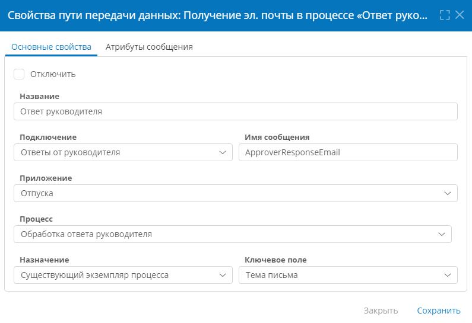
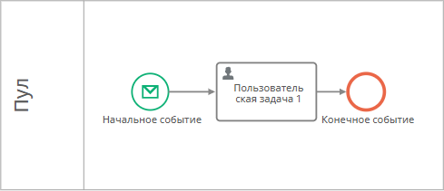
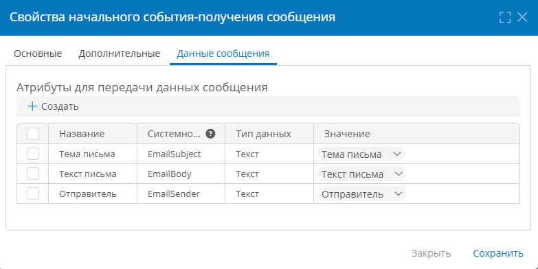

# Получение эл.&nbsp;почты в процессе. Настройка подключения, пути передачи данных и процесса {: #process_receiving_connection }

## Введение {: #process_receiving_connection_intro }

Здесь представлены инструкции по настройке подключения и пути передачи данных из эл. писем в бизнес-процессе.

Кроме того, потребуется настроить **[начальное][process_diagram_elements_receive_message_start_event]** или **[промежуточное][process_diagram_elements_receive_message_intermediate_event] событие-получение сообщения** на диаграмме процесса.

Подробный пример настройки приложения для обмена данными посредством эл.&nbsp;почты см. в статье _«[Пример: согласование заявлений по эл.&nbsp;почте. Настройка подключений, путей передачи данных и диаграммы процесса][process_email_configure]»_.

## Порядок настройки получения эл. писем {: #process_receiving_connection_sequence }

1. [Настройте подключение](#process_receiving_connection_configure) типа «**Получение эл.&nbsp;почты в процессе**».
2. [Настройте путь передачи данных](#process_receiving_connection_route_configure) типа «**Получение эл.&nbsp;почты в процессе**».
3. Настройте [начальное или промежуточное событие-получение сообщения](#process_receiving_connection_message_event_configure) на диаграмме процесса:

    - укажите настроенный **путь передачи данных**;
    - настройте сопоставление **данных сообщения**.

## Настройка подключения {: #process_receiving_connection_configure }



1. На странице **Администрирование**» выберите пункт «**Инфраструктура**» — «[**Подключения**][connections]» <i class="fal fa-exchange-alt"></i>.
2. Откройте или создайте **подключение к электронной почте** типа «**Получение эл.&nbsp;почты в процессе**».
3. Настройте подключение:

    - **Отключить** — установите этот флажок, если требуется временно деактивировать данное подключение.
    - **Название** — укажите наименование подключения.
    - **Протокол** — выберите почтовый протокол:
        - **IMAP**
            - **Порт** — укажите порт для подключения к почтовому серверу.
            - **Защита данных** — выберите протокол шифрования:
                - **Нет**;
                - **SSL**;
                - **TLS**.
        - **Microsoft Exchange**
            - **Домен** — укажите домен для доступа к серверу Exchange.
            - **Версия** — выберите версию сервера Exchange.
    - **Адрес почтового сервера** — укажите URL почтового сервера.

        !!! note "Примечание"

            - Для **SMTP не** указывайте протокол (`SMTP`, `HTTPS`, `HTTP`).
            - Для **Exchange укажите** протокол (`HTTPS`, `HTTP`).

    - **Имя пользователя** — укажите учётную запись для подключения к почтовому серверу.
    - **Пароль** — введите пароль к учётной записи для подключения к почтовому серверу.
    - **Интервал опроса** — укажите интервал, с которым **{{ productName }}** будет проверять наличие новых писем.
    - **Проверить соединение** — нажмите эту кнопку, чтобы проверить соединение с почтовым сервером.

4. Нажмите кнопку «**Создать**».

## Настройка пути передачи данных {: #process_receiving_connection_route_configure .pageBreakBefore }

Путь передачи данных типа «**Получение эл.&nbsp;почты в процессе**» служит для преобразования и передачи данных из эл. письма в **{{ productName }}**.

1. Откройте страницу «**Администрирование**» — «**Архитектура**» или страницу «**Администрирование**» приложения.
2. Выберите пункт «[**Пути передачи данных**][communication_routes]» <i class="fa-light fa-route " aria-hidden="true"></i>.
3. Откройте или создайте путь передачи данных типа «**Подключения к электронной почте**» – «**Получение эл.&nbsp;почты в процессе**».
4. Настройте свойства пути передачи данных на следующих вкладках:

    - [**Основные свойства**](#process_receiving_communication_route_properties_general)
    - [**Атрибуты сообщения**](#process_receiving_communication_route_properties_message_attributes)

5. Сохраните путь передачи данных.

### Основные свойства {: #process_receiving_communication_route_properties_general .pageBreakBefore }

На вкладке «**Основные свойства**» настройте базовые параметры пути передачи данных:

- **Отключить** — установите этот флажок, чтобы временно деактивировать путь передачи данных.
- **Название** — введите наглядное наименование пути передачи данных.
- **Подключение** — выберите подключение типа «**Получение эл.&nbsp;почты в процессе**».
- **Имя сообщения** — введите _уникальный_ идентификатор сообщения, проходящего по данному пути передачи данных.
- **Приложение** — выберите бизнес-приложение, в котором будет использоваться путь передачи данных.
- **Процесс** — выберите процесс из приложения, в котором будет использоваться путь передачи данных.
- **Назначение**:
    - **Новый экземпляр процесса** — полученное сообщение будет создавать новый экземпляр указанного процесса;
    - **Существующий экземпляр процесса** — полученное сообщение будет отправлено в определенный экземпляр указанного процесса.
- **Ключевое поле** — атрибут для поиска существующего экземпляра процесса. Доступно при указании «**Существующий экземпляр процесса**» в «**Назначении**».

__

### Атрибуты сообщения {: #process_receiving_communication_route_properties_message_attributes .pageBreakBefore }

Чтобы извлечь данные из эл. письма и передать их в **{{ productName }}**, сопоставьте набор **атрибутов сообщения** с полями письма:

1. Добавьте атрибут сообщения, нажав кнопку «**Создать**».
2. Заполните свойства атрибута:

    - **Название** — наглядное название атрибута.
    - **Системное имя** — уникальное имя атрибута (для эл. писем может быть произвольным).
    - **Тип данных**:
        - **Текст**
        - **Число**
        - **Длительность**
        - **Дата и время**
        - **Логический**
        - **Документ**
        - **Аккаунт**
    - **Поле сообщения** — выберите поле письма, значение которого требуется присвоить атрибуту сообщения:
        - **Адрес отправителя**
        - **Имя отправителя**
        - **Адрес получателя**
        - **Имя получателя**
        - **Тема**
        - **Сообщение**
        - **Адрес для отправки копии**
        - **Имя для отправки копии**
        - **Адрес для отправки скрытой копии**
        - **Имя для отправки скрытой копии**
        - **Прикреплённые файлы**
        - **ID сообщения**
        - **Дата получения сообщения**

3. Настройте передачу значений атрибутов сообщения в атрибуты записи с помощью вкладки «**Данные сообщения**» в свойствах [**события-получения сообщения**][process_diagram_elements_receive_message_start_event], использующего этот путь передачи данных.

!!! example "Пример извлечения текста эл. письма"

    Настройте **атрибут сообщения** следующим образом:
    
    - **Название:** _Текст письма_
    - **Системное имя:** _EmailBody_
    - **Тип данных: текст**
    - **Поле сообщения: сообщение**

__

## Настройка события-получения сообщения {: #process_receiving_connection_message_event_configure }

--8<-- ".snippets/email_parse_logics.md"

1. Поместите на диаграмму процесса [начальное][process_diagram_elements_receive_message_start_event] или [промежуточное][process_diagram_elements_receive_message_intermediate_event] событие-получение сообщения.

    __

2. В меню элемента события нажмите кнопку «**Свойства**» <i class="fa-light fa-gear">‌</i>.
3. На вкладке «**Основные**» настройте [общие свойства элемента][process_diagram_element_common_properties].
4. На вкладке «**Дополнительные**» выберите ранее созданный [путь передачи данных](#process_receiving_connection_route_configure).
5. На вкладке «**Данные сообщения**» сопоставьте **[атрибуты сообщения](#process_receiving_communication_route_properties_message_attributes)** с атрибутами **[шаблона записи][record_templates]**, связанного с шаблоном процесса:

    - Укажите название, системное имя и тип данных **атрибутов сообщения** так же, как они указаны в таблице «**Атрибуты для передачи данных сообщения**» в [свойствах пути передачи данных](#process_receiving_communication_route_properties_message_attributes).
    - В столбце «**Значение**» укажите атрибут **шаблона записи** такого же типа, как **атрибут сообщения**.
    - Значения указанных **атрибутов сообщения**  будут присвоены атрибутам **шаблона записи**.

    __

6. Опубликуйте процесс.

--8<-- "related_topics_heading.md"

- _[Начальное событие-получение сообщения][process_diagram_elements_receive_message_start_event]_
- _[Промежуточное событие-получение сообщения][process_diagram_elements_receive_message_intermediate_event]_
- _[Отправка, получение и обработка эл.&nbsp;почты в процессе. Пример: настройка подключений, путей передачи данных, диаграммы процесса и сценария][process_email_configure]_
- _[Отправка эл.&nbsp;почты из процесса. Настройка подключения, пути передачи данных и события на диаграмме процесса][process_sending_connection]_
- _[Получение эл.&nbsp;почты с помощью сценария через Exchange и IMAP. Настройка подключения, пути передачи данных и сценария][scenario_receive_email]_
- _[Отправка эл.&nbsp;почты из сценариев через SMTP и Exchange. Настройка подключения, пути передачи данных и сценария][scenario_send_email]_
- _[Получение веб-запросов в процессе. Настройка подключения, пути передачи данных и процесса][get_connection]_


