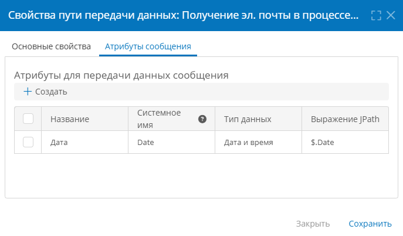
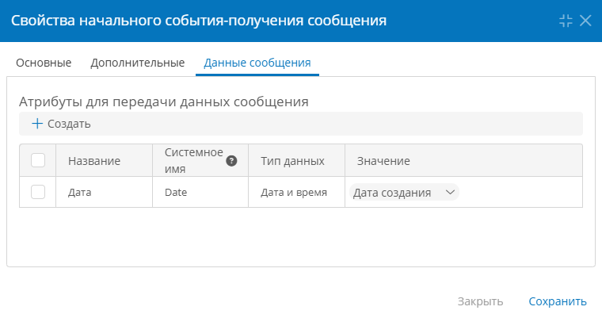

# Получение веб-запросов в процессе. Настройка подключения, пути передачи данных и процесса {: #get_connection }

## Введение {: #get_connection_intro }

**{{ productName }}** может принимать в процессах веб-запросы типа `GET` для взаимодействия с внешними системами.

Настроенное подключение типа «**Получение веб-запросов**» используется в [пути передачи данных](#get_connection_communication_route_configure), который, в свою очередь, применяется в **[начальном событии-получении сообщения][process_diagram_elements_receive_message_start_event]** и **[промежуточном событии-получении сообщения][process_diagram_elements_receive_message_intermediate_event]** на диаграмме процесса.

## Порядок настройки получения веб-запросов {: #get_connection_sequence }

1. [Настройте подключение](#get_connection_connection_configure) типа «**Получение веб-запросов**».
2. [Настройте путь передачи данных](#get_connection_communication_route_configure) типа «**Получение эл.&nbsp;почты в процессе**».
3. Настройте [начальное или промежуточное событие-получение сообщения](#get_connection_message_event_configure) на диаграмме процесса:

    - укажите настроенный **путь передачи данных**;
    - настройте сопоставление **данных сообщения**.

## Настройка подключения {: #get_connection_connection_configure }

1. На странице **Администрирование**» выберите пункт «[**Подключения**][connections]» <i class="fal fa-exchange-alt"></i>.
2. Откройте или создайте подключение типа «**Подключения REST и OData**» — «**Получение веб-запросов**».
3. Настройте свойства подключения.

    - **Отключить** — установите этот флажок, если требуется деактивировать подключение.
    - **Название** — введите наглядное наименование подключения.
    - **URL для получения внешних запросов** — введите суффикс для веб-запросов. Например, для обработки запросов на получение списка контрактов можно указать: `getContracts`. Префикс `https://` и символ `/` в конце URL не требуются.
    - **URL обслуживания запросов** — в этом поле отобразится итоговый URL-адрес, на который внешние системы должны будут отправлять HTTP-запросы.
    - **Данные для страницы ответа** — настройте внешний вид веб-страницы ответа на запрос, отображающейся в веб-браузере:

        - **Заголовок страницы** — введите текст заголовка веб-страницы с ответом;
        - **Тело страницы** — введите текст сообщения на веб-странице с ответом.

4. Нажмите кнопку «**Создать**».

__

__

## Настройка пути передачи данных {: #get_connection_communication_route_configure .pageBreakBefore }

Путь передачи данных типа «**Получение эл.&nbsp;почты в процессе**» служит для преобразования и передачи данных из HTTP-запроса в **{{ productName }}**.

1. Откройте страницу «**Администрирование**» — «**Архитектура**» или страницу «**Администрирование**» приложения.
2. Выберите пункт «[**Пути передачи данных**][communication_routes]» <i class="fa-light fa-route " aria-hidden="true"></i>.
3. Откройте или создайте путь передачи данных типа «**Подключения к электронной почте**» — «**Получение эл.&nbsp;почты в процессе**».
4. Настройте свойства пути передачи данных на следующих вкладках:

    - [**Основные свойства**](#get_connection_communication_route_properties_general)
    - [**Атрибуты сообщения**](#get_connection_communication_route_properties_message_attributes)

5. Сохраните путь передачи данных.

### Основные свойства {: #get_connection_communication_route_properties_general .pageBreakBefore }

На вкладке «**Основные свойства**» настройте базовые параметры пути передачи данных:

- **Отключить** — установите этот флажок, чтобы временно деактивировать путь передачи данных.
- **Название** — введите наглядное наименование пути передачи данных.
- **Подключение** — выберите подключение типа «**Получение веб-запросов**».
- **Имя сообщения** — введите _уникальный_ идентификатор сообщения, проходящего по данному пути передачи данных.
- **Приложение** — выберите бизнес-приложение, в котором будет использоваться путь передачи данных.
- **Процесс** — выберите процесс из приложения, в котором будет использоваться путь передачи данных.
- **Назначение**:
    - **Новый экземпляр процесса** — полученное сообщение будет создавать новый экземпляр указанного процесса;
    - **Существующий экземпляр процесса** — полученное сообщение будет отправлено в определенный экземпляр указанного процесса.
- **Ключевое поле** — атрибут для поиска существующего экземпляра процесса. Доступно при указании «**Существующий экземпляр процесса**» в «**Назначении**».
- **Метод парсинга ответа** — выберите метод анализа данных:
    - **Не преобразовывать**;
    - **XML**;
    - **JSON**;
    - **Строка запроса**.

### Атрибуты сообщения {: #get_connection_communication_route_properties_message_attributes .pageBreakBefore }

Чтобы извлечь данные из HTTP-запроса и передать их в **{{ productName }}**, сопоставьте набор **атрибутов сообщения** с полями запроса:

1. Добавьте атрибут сообщения, нажав кнопку «**Создать**».
2. Заполните свойства атрибута:

    - **Название** — наглядное название атрибута.
    - **Системное имя** — уникальное имя атрибута.
    - **Тип данных**:
        - **Текст**
        - **Число**
        - **Длительность**
        - **Дата и время**
        - **Логический**
        - **Документ**
        - **Аккаунт**
    - Задайте поле запроса, значение которого требуется присвоить атрибуту сообщения, в зависимости от **метода парсинга ответа**, выбранного на вкладке «**Основные свойства**»:
        - **Поле сообщения** — установите флажок, чтобы передать значение из поля запроса **без преобразования**, **системное имя атрибута сообщения** должно совпадать с именем соответствующего поля запроса;
        - **Выражение JPath** — введите путь к полю запроса в формате **JSON**;
        - **Выражение XPath** — введите путь к полю запроса в формате **XML**;
        - **Строка запроса** — введите имя поля запроса.

!!! example "Пример извлечения поля _Date_ из HTTP-запроса по JSONPath"

    Настройте **атрибут сообщения** следующим образом:

    - **Название:** _Дата_
    - **Системное имя:** _Date_
    - **Тип данных: дата и время**
    - **Выражение JPath:** `$.Date`

    Подробные сведения об использовании JSONPath см. в статье _«[HTTP-запросы. Получение и обработка данных с помощью JSONPath][http_receive_jpath]»_.

__

## Настройка события-получения сообщения {: #get_connection_message_event_configure }

Атрибуты сообщения, настроенные в пути передачи данных, сопоставляются с атрибутами шаблона записи на вкладке «**Данные сообщения**» в свойствах [**события-получения сообщения**][process_diagram_elements_receive_message_start_event]. Порядок настройки события:

1. Перейдите в шаблон процесса и откройте диаграмму.
2. Поместите на диаграмму процесса [начальное][process_diagram_elements_receive_message_start_event] или [промежуточное][process_diagram_elements_receive_message_intermediate_event] событие-получение сообщения.
3. В меню элемента события нажмите кнопку «**Настроить**» <i class="fa-light fa-gear">‌</i>.
4. На вкладке «**Основные**» настройте [общие свойства элемента][process_diagram_element_common_properties].
5. На вкладке «**Дополнительные**» выберите ранее созданный [путь передачи данных](#get_connection_communication_route_configure).
6. На вкладке «**Данные сообщения**» сопоставьте **[атрибуты сообщения](#get_connection_communication_route_properties_message_attributes)** с атрибутами **[шаблона записи][record_templates]**, связанного с шаблоном процесса:

    - Укажите название, системное имя и тип данных **атрибутов сообщения** так же, как они указаны в таблице «**Атрибуты для передачи данных сообщения**» в [свойствах пути передачи данных](#get_connection_communication_route_properties_message_attributes).
    - В столбце «**Значение**» укажите атрибут **шаблона записи** такого же типа, как **атрибут сообщения**.
    - Значения указанных **атрибутов сообщения** будут присвоены атрибутам **шаблона записи**.

    __

7. Опубликуйте процесс.

--8<-- "related_topics_heading.md"

- _[Начальное событие-получение сообщения][process_diagram_elements_receive_message_start_event]_
- _[Промежуточное событие-получение сообщения][process_diagram_elements_receive_message_intermediate_event]_
- _[Получение эл.&nbsp;почты в процессе. Настройка подключения, пути передачи данных и процесса][process_receiving_connection]_
- _[Отправка веб-запросов. Настройка подключения][http_send_request_connection]_


